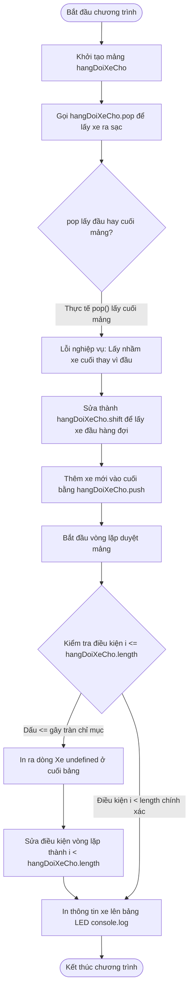

# BÁO CÁO BÀI TẬP: KHẮC PHỤC LỖI THAM CHƯỚC VÙNG NHỚ MẢNG VÀ XỬ LÝ HÀNG ĐỢI TRẠM SẠC

> 👤 **Học viên:** Hoàng Công Dũng | **Mã SV:** PTIT-HCM-009
> 🏫 **Môn học:** it103b-rl-HoangCongDung

---

## 📊 Sơ đồ thiết kế hệ thống (Flowchart)

> 💡 *Sơ đồ dưới đây được render tự động trực tiếp trên GitHub bằng Mermaid. Bạn cũng có thể tải file **`bt2.drawio`** trong repository này để mở và chỉnh sửa trực tiếp trên [Draw.io (diagrams.net)](https://app.diagrams.net).* 

---

## Nhiệm vụ 1: Phân tích lỗi và Lập bảng Test Cases

Sau khi đọc kỹ mã nguồn hiện tại của trạm sạc VinFast, em phát hiện ra hai lỗi cốt lõi gây sai lệch nghiệp vụ thực tế.

Thứ nhất, phương thức .pop() trong JavaScript dùng để xóa và trả về phần tử CUỐI CÙNG của mảng. Trong khi đó, hàng đợi xe chờ sạc hoạt động theo cơ chế FIFO (First In, First Out) - xe vào trước phải được phục vụ trước, tức là lấy xe ở ĐẦU mảng bằng phương thức .shift(). Dùng .pop() làm trạm sạc lấy nhầm xe vừa mới xếp hàng thay vì xe đã đợi lâu nhất.

Thứ hai, vòng lặp for sử dụng điều kiện i <= hangDoiXeCho.length. Do mảng trong JS đánh chỉ mục (index) từ 0, một mảng có length bằng N sẽ có phần tử hợp lệ từ 0 đến N-1. Việc dùng dấu bé hơn hoặc bằng (<=) khiến vòng lặp chạy thêm 1 lần thừa khi i = N, dẫn đến việc gọi phần tử hangDoiXeCho[N] trả về giá trị undefined, làm dòng cuối bảng LED hiển thị lỗi 'Xe undefined'.

- Nguyên nhân lỗi 1: Nhầm lẫn giữa cơ chế LIFO của stack (.pop) và FIFO của queue (.shift).
- Nguyên nhân lỗi 2: Lỗi tràn chỉ mục mảng (Index Out of Bounds) do dùng toán tử so sánh sai trong vòng lặp.
- Hậu quả nghiệp vụ: Khách hàng vào trước bị phục vụ sau, bảng LED hiển thị dòng rác 'Xe undefined' gây mất uy tín hệ thống.

| Trường hợp kiểm thử | Dữ liệu đầu vào | Kết quả sai thực tế | Kết quả đúng mong đợi |
| --- | --- | --- | --- |
| TC01: Lấy xe vào cổng sạc | hangDoiXeCho = ['30A-98765', '29B-12345', '51C-45678'] | Lấy ra xe '51C-45678' (xe cuối mảng do dùng .pop()) | Lấy ra xe '30A-98765' (xe đầu mảng bằng .shift()) |
| TC02: In danh sách lên bảng LED | Mảng sau khi thêm xe mới có length = 3 | In 4 dòng: STT 1, 2, 3 và dòng thứ 4 hiển thị 'STT 4: undefined' | In chính xác 3 dòng danh sách xe hiện tại, không có dòng undefined |

## Nhiệm vụ 2: Sửa lỗi mã nguồn

Em đã tiến hành viết lại toàn bộ mã nguồn vào tệp 'solution_ex2.js' theo đúng các tiêu chuẩn kỹ thuật được học. Toàn bộ thao tác mảng đã được chuẩn hóa để đảm bảo cơ chế hàng đợi hoạt động chính xác tuyệt đối.

- Thay thế hangDoiXeCho.pop() thành hangDoiXeCho.shift() để lấy đúng xe đầu hàng đợi.
- Sử dụng hangDoiXeCho.push('43D-88888') để thêm xe mới vào đúng cuối hàng đợi.
- Sửa điều kiện vòng lặp thành i < hangDoiXeCho.length để triệt tiêu hoàn toàn lỗi in ra 'Xe undefined'.

---

## 📁 Danh sách tệp tin nộp bài trong Repository
- 📝 `bt2.docx`: Báo cáo tài liệu phân tích nghiệp vụ hoàn chỉnh.
- 🎨 `bt2.drawio`: File thiết kế sơ đồ chuẩn theo quy định đề bài (mở trực tiếp bằng [Draw.io](https://app.diagrams.net) hoặc Lucidchart).
- 💻 `solution_ex2.js`: Mã nguồn chương trình.
